# Morserino-32 Nano — hardware & wiring

This page describes how to build the Nano. For what the Nano is and how it
differs from the Morserino-32 Pocket, see the [main README](../../README.md).

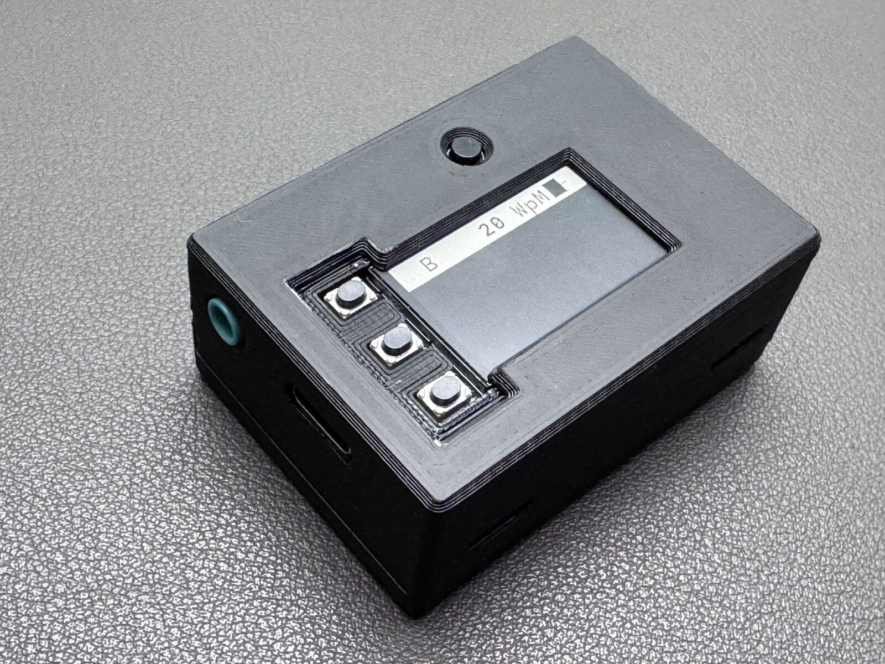

The case is 3D-printed; here it is next to a matchbox for scale, and opened up:

| Size | Inside |
|---|---|
| 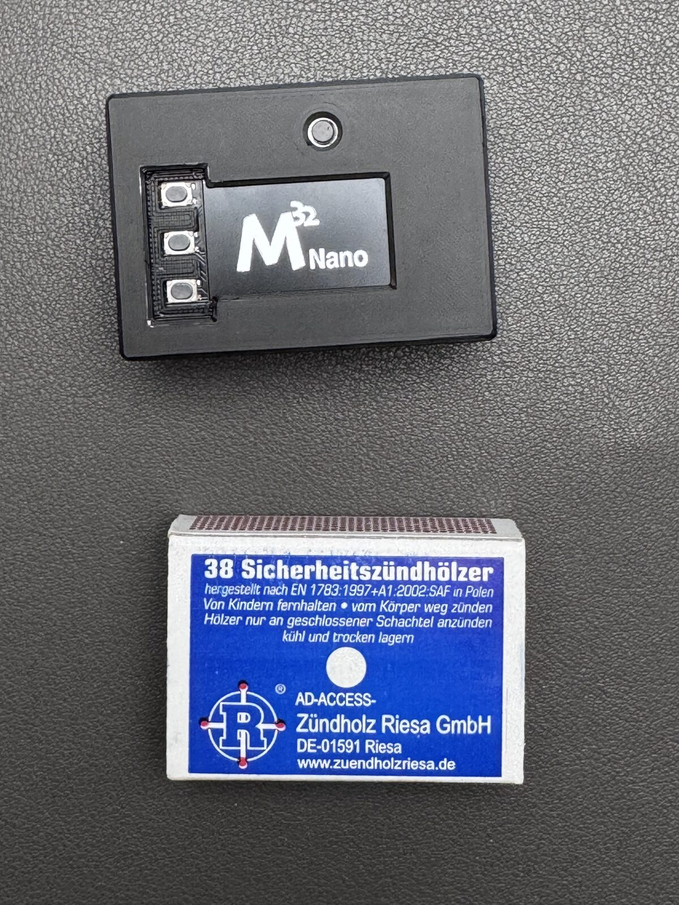 | 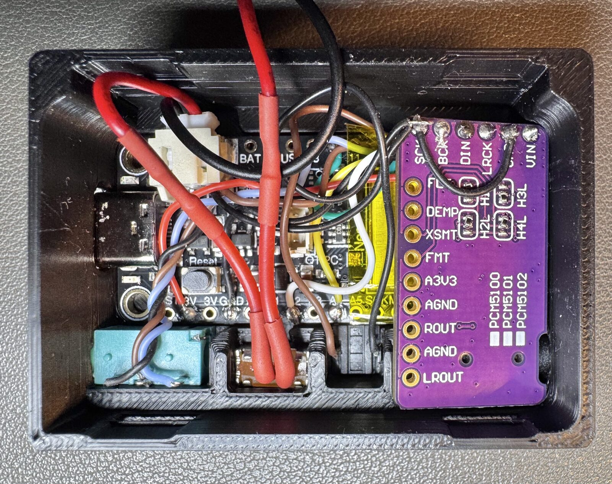 |

## Bill of material

| # | Part | Qty | Notes |
|---|---|---|---|
| 1 | [Adafruit ESP32-S3 Reverse TFT Feather](https://www.adafruit.com/product/5691) (#5691) | 1 | MCU, 240×135 TFT, 3 buttons (D0/D1/D2), USB-C, LiPo charger, MAX17048 fuel gauge |
| 2 | PCM5102A I²S DAC module **with 3.5 mm headphone jack** | 1 | purple board, pins SCK / BCK / DIN / LCK / GND / VIN — the headphone jack is on this board |
| 3 | 3.5 mm stereo jack, PCB type, 5 pins (teal) | 1 | the key / paddle jack |
| 4 | Pushbutton (round, panel mount) | 1 | the external **FN** button, on top of the case |
| 5 | [LiPo cell 3.7 V, 800 mAh, type 752248, with JST-PH plug](https://amzn.eu/d/00VhmSqJ) | 1 | optional — the Nano also runs from USB |
| 6 | Slide switch, PCB mount, ON-ON, 8.6×4.3×4 mm, angled ([BerryBase](https://www.berrybase.at/schiebeschalter-printmontage-on-on-2-stellig-8.6x4.3x4mm-gewinkelt)) | 1 | battery on/off switch, in the **+** lead of the LiPo |
| 7 | Hook-up wire, heat-shrink, Kapton tape, a little foam | – | see below |
| 8 | 3D-printed case | 1 | *(print files still to be added)* |

**Purchase links** (still to be matched to the parts above):
[Adafruit #5691](https://www.adafruit.com/product/5691) ·
[Amazon.de B0CSS7DX1T](https://www.amazon.de/dp/B0CSS7DX1T) ·
[Amazon.de B0F7LL4S8Z](https://www.amazon.de/dp/B0F7LL4S8Z) ·
[Amazon.de B0GS9WTZ6Q](https://www.amazon.de/dp/B0GS9WTZ6Q) ·
[Amazon.de B07XWYHPZH](https://www.amazon.de/dp/B07XWYHPZH) ·
[BerryBase slide switch](https://www.berrybase.at/schiebeschalter-printmontage-on-on-2-stellig-8.6x4.3x4mm-gewinkelt)

| Feather and DAC | The teal key jack | The battery switch |
|---|---|---|
| 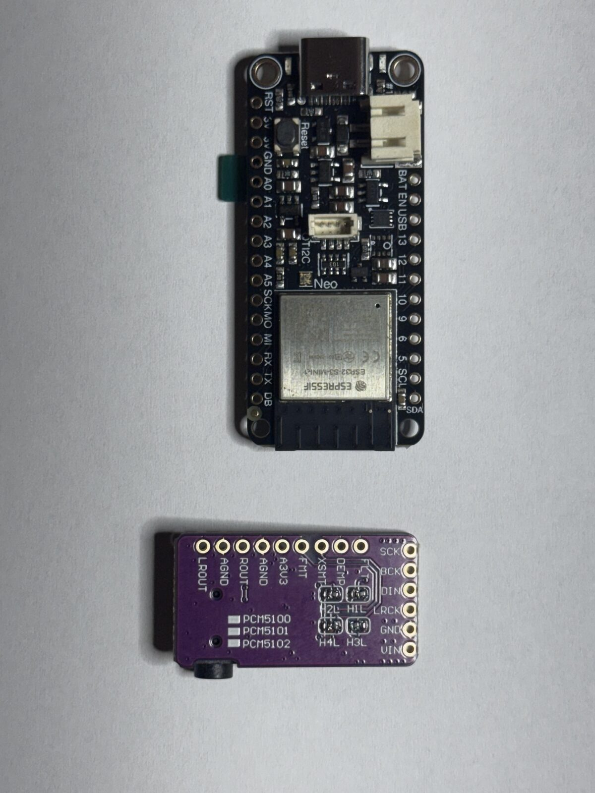 | 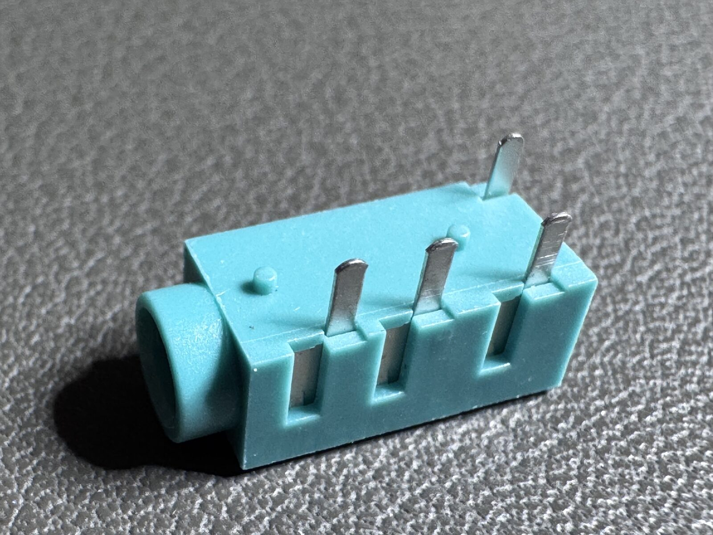 | 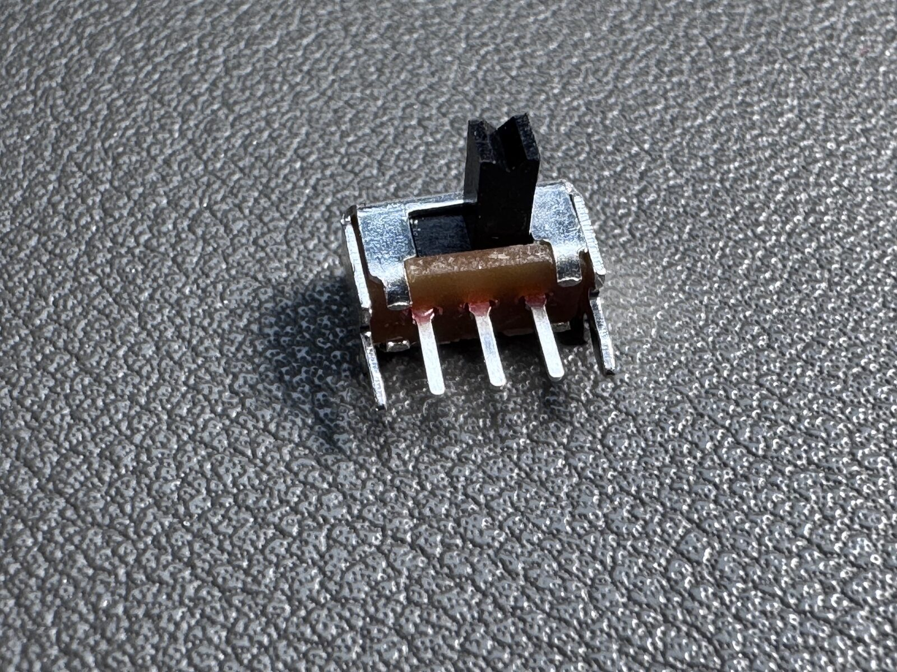 |

## Wiring overview

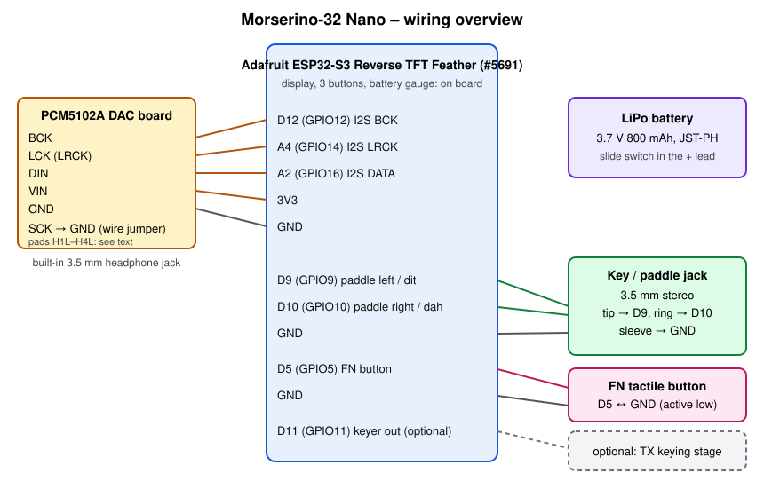

> The pin assignments are taken from the firmware
> (`Software/src/platformio.ini`, environment `nano-adafruit-feather`) and
> match the photos of the build. Header names (D5, A2, …) are those printed on
> the Feather.

### Audio: PCM5102A (I²S)

| Feather pin | GPIO | Wire colour in the photos | DAC pin |
|---|---|---|---|
| D12 | 12 | green | BCK |
| A4 | 14 | yellow | LCK (LRCK) |
| A2 | 16 | white | DIN |
| 3V | – | red | VIN |
| GND | – | black | GND |

In addition, a short wire links **SCK to GND** on the DAC board (the black
loop in the photos). Headphones plug into the jack on the DAC board — there is
no speaker.

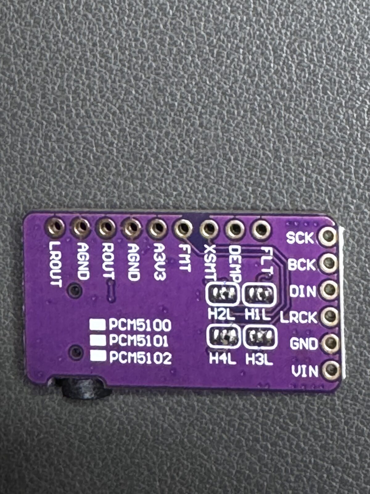
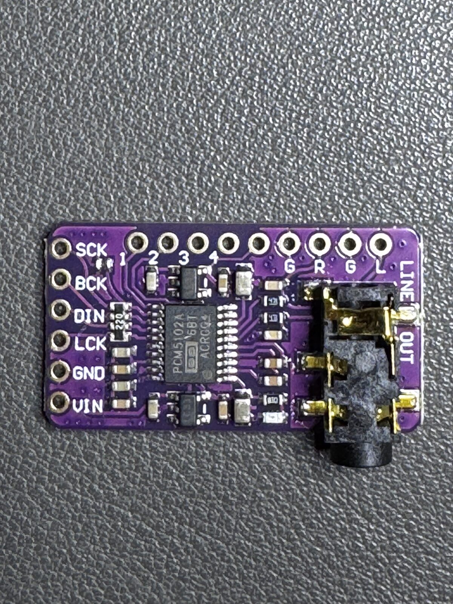

> **To confirm:** the four solder pads **H1L–H4L** on the back of the DAC board
> (they select filter, de-emphasis, soft-mute and I²S format). State here how
> they are set on your board.

### Key / paddle and FN button

| Function | Feather pin | GPIO | Wiring |
|---|---|---|---|
| Paddle left (dit) | D9 | 9 | key jack → pin |
| Paddle right (dah) | D10 | 10 | key jack → pin |
| Key jack, common | GND | – | key jack sleeve |
| **FN** button | D5 | 5 | button between pin and GND |
| Keyer out (optional) | D11 | 11 | not used in this build |

No external resistors are needed: the firmware enables the internal pull-ups,
and the key just shorts the pin to GND.

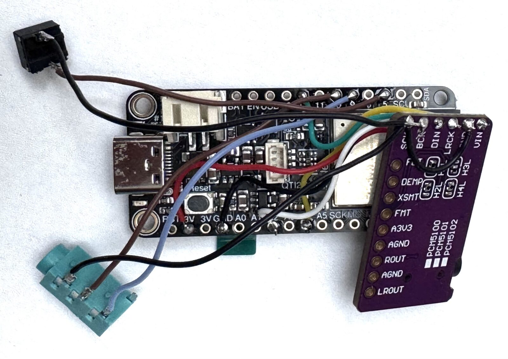

> **To confirm:** which jack contact (tip / ring) goes to D9 and D10.

### Battery and power switch

The LiPo's JST-PH plug goes into the Feather's battery connector. The slide
switch interrupts the red (+) wire; the black (−) wire goes straight through.
The cell charges via USB-C. Check the polarity of any LiPo you buy: JST-PH
cells are **not** all wired the same way.

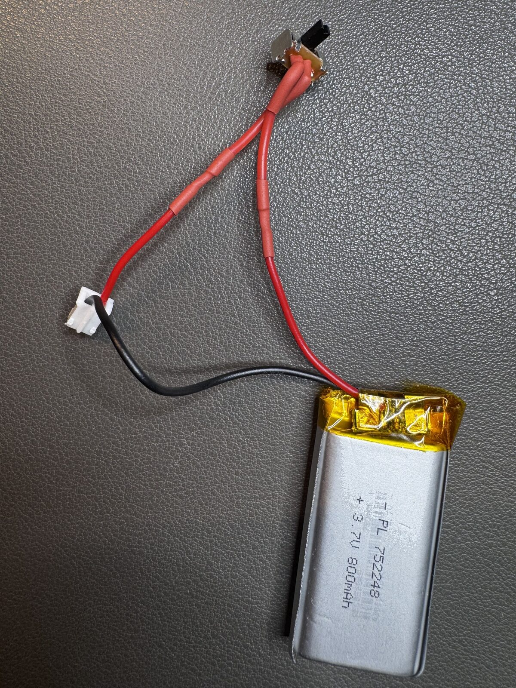

### Built-in parts (no wiring)

| Part | Used for |
|---|---|
| Button **D0** (top, BOOT) | encoder "turn right" (+1) |
| Button **D1** (middle) | encoder click / select |
| Button **D2** (bottom) | encoder "turn left" (−1) |
| ST7789 TFT, 240×135 | display (landscape) |
| MAX17048 (I²C 0x36) | battery voltage / charge |

Do not use GPIO 0–4, 7, 35–36, 40–42 or 45 for anything else: the board itself
uses them.

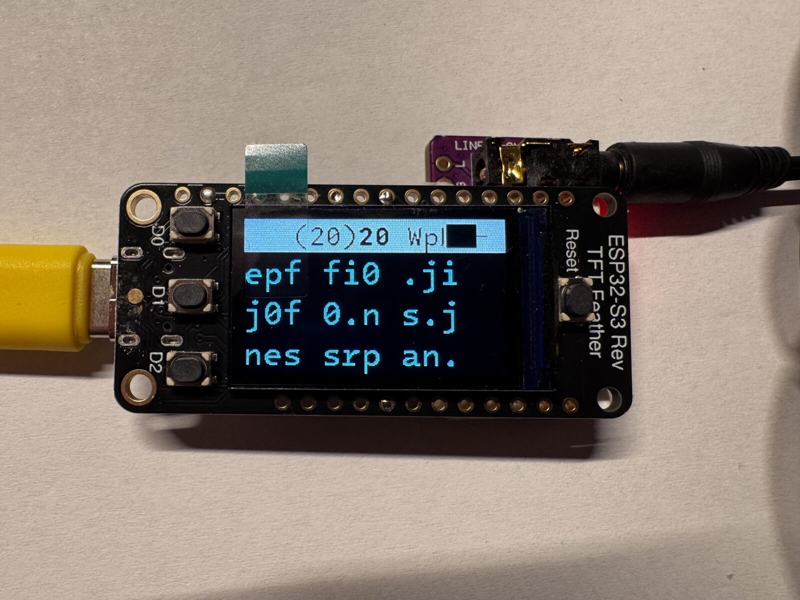

## Assembly notes

- The DAC board sits **behind** the Feather. A piece of Kapton tape over the
  ESP32 module and a little foam keep the two boards from touching.
- The wires leave the Feather on its rear header pads and run to the DAC pins
  along the edge.

| Wiring, back | Close-up | Stack, side view |
|---|---|---|
| 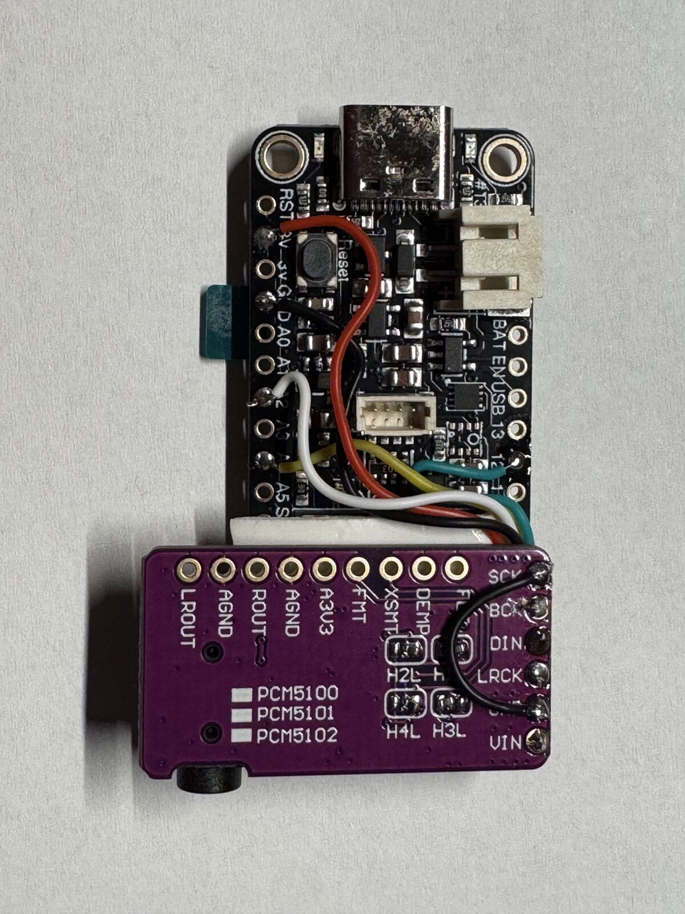 | 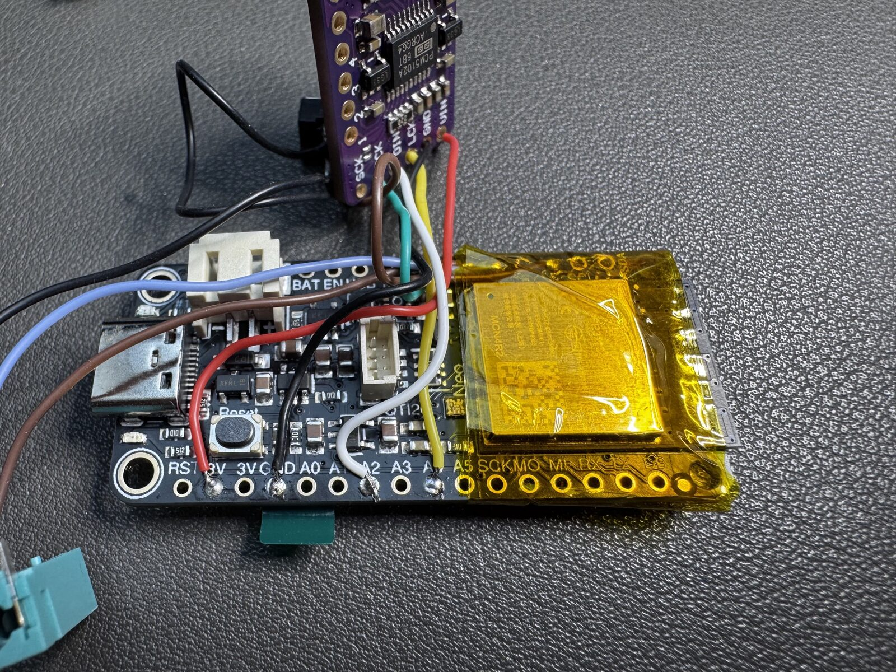 | 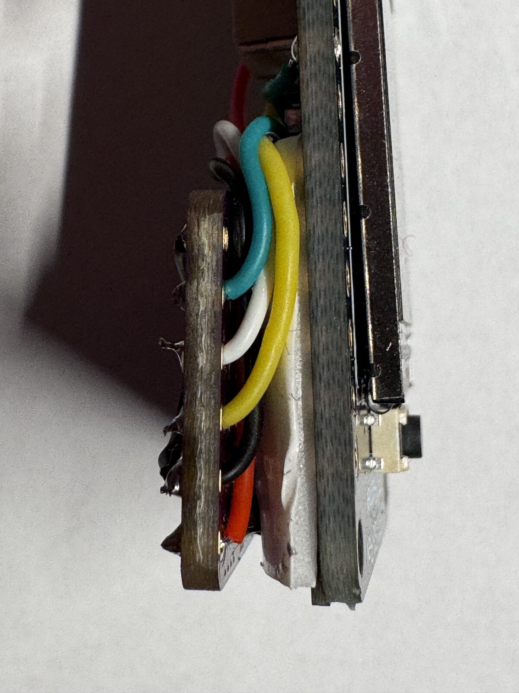 |

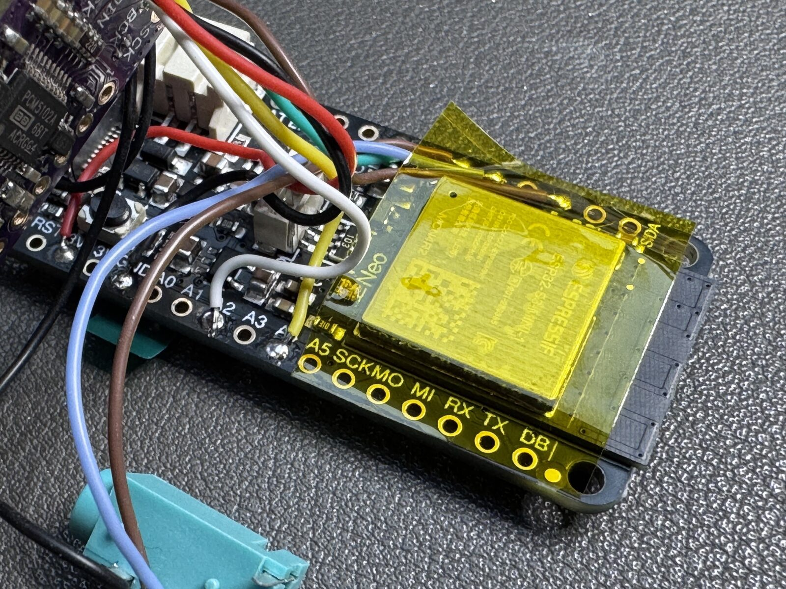
