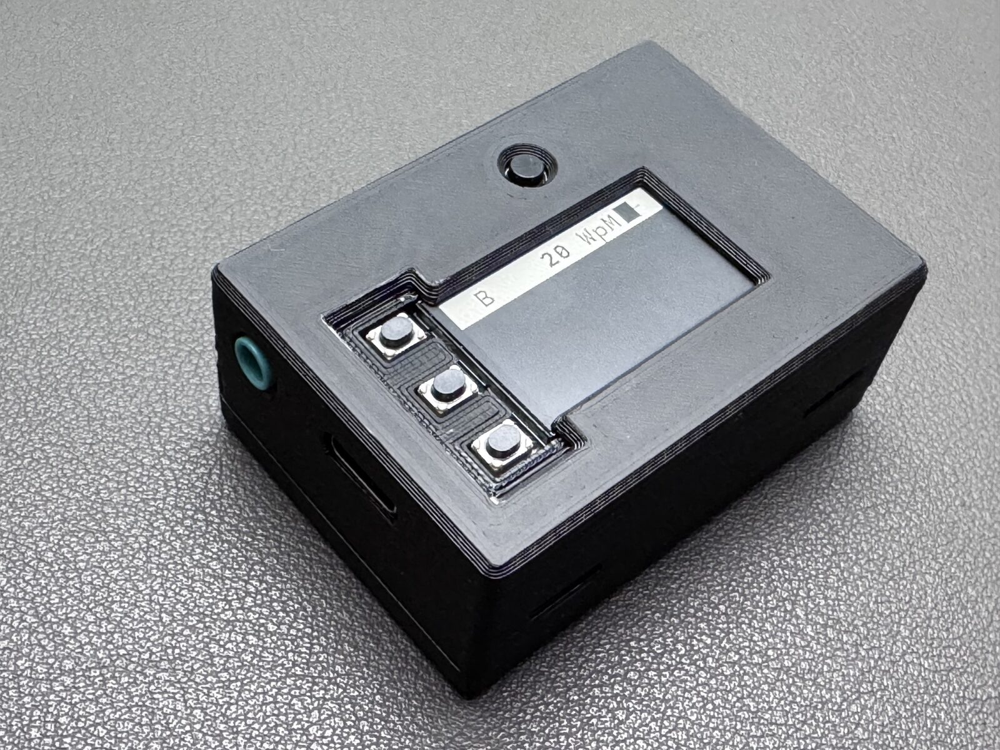

# Morserino-32 Nano

**A compact, DIY variant of the [Morserino-32 Pocket](https://github.com/oe1wkl/Morserino-32)
that runs on different hardware: an Adafruit ESP32-S3 Reverse TFT Feather
plus a small I²S DAC board.**

This repository is a fork of Willi Kraml's (OE1WKL) Morserino-32 project. The
firmware is the Pocket firmware, ported to the Feather. All credit for the
Morserino itself goes to Willi and the Morserino-32 contributors; this fork only
adds the board support described below. It is **not** an official Morserino
product, and it is not supported by the original project — please report
Nano problems here, not there.


*The Nano in its 3D-printed case. Wiring and parts list: [Documentation/Nano](Documentation/Nano/README.md).*

## What is different from the Pocket?

| | Morserino-32 Pocket | Morserino-32 **Nano** |
|---|---|---|
| Board | custom ESP32-S3 PCB (kit) | Adafruit ESP32-S3 Reverse TFT Feather (#5691) + PCM5102A DAC |
| Display | LCD, 320×170 | built-in TFT, 240×135 (fewer text lines) |
| Input | rotary encoder, buttons | the 3 built-in buttons simulate the encoder (up / down / click) + 1 external **FN** button |
| Sound | speaker and headphones | **headphones only** (PCM5102A DAC module with its own headphone jack, no speaker) |
| Key / paddle | jack, touch paddles | jack only, touch paddles disabled |
| Battery | ADC | LiPo 800 mAh with on/off slide switch; MAX17048 fuel gauge on the Feather |
| LoRa | optional | not available |
| Firmware env | `pocketwroom` | `nano-adafruit-feather` |

## What is (and is not) ported

**Works:** CW Keyer, CW Generator, Echo Trainer, Koch Trainer, iCW / external
transceiver mode, QSO Bot, practice statistics, WiFi, Bluetooth (keyboard and
BLE serial), the serial protocol, snapshots and preferences. The scroll area
has 3 lines (4 with the small font); the boot logo says "Nano".

**Not available on the Nano:**

- the four **CW games** (Morse Invaders, Fight the Pileup, Radio Cave, Morsel) —
  their screen layout needs more than 135 px of height
- the **CW Decoder** — the board has no audio input
- **LoRa**
- speaker, microphone / audio in, rotary encoder, touch paddles
- the Accessibility Edition (spoken UI)

Because the Nano shares the Pocket code, features may still change as upstream
evolves; see the commit history for what has been adapted.

## Build it yourself

- Parts list, pin assignment and wiring diagram: **[Documentation/Nano](Documentation/Nano/README.md)**
- Short version: Feather + PCM5102A on three I²S pins (GPIO 12 / 14 / 16), paddle jack on
  GPIO 9 / 10, FN button on GPIO 5.
- ⚠️ **Check the LiPo plug polarity before connecting the battery.** JST-PH cells are wired
  differently by different vendors; a reversed battery destroys the board and can harm the
  USB port of your computer. Details in the [wiring page](Documentation/Nano/README.md#battery-and-power-switch).

## Flash the firmware

Build with [PlatformIO](https://platformio.org/) from `Software/src/`:

```bash
pio run -e nano-adafruit-feather
pio run -e nano-adafruit-feather -t upload
```

The Feather enters its bootloader automatically over USB-C (1200 bps touch);
if not, hold **D0** while pressing reset. The upstream web installer at
morserino.info installs the original Morserino devices, **not** the Nano.

## Using it

The Nano behaves like the Pocket, so the Pocket documentation applies — with
the differences above (the three buttons replace the encoder: D0 = right,
D2 = left, D1 = click; FN is the external button).

---

# Upstream: Morserino-32

*Everything below is the original project README, kept for reference.*

## User Manual (Pocket)

There is one manual per Morserino, so you only read what applies to your device.

| Your Morserino | English | Deutsch |
|---|---|---|
| **Morserino-32 Pocket** | [PDF](https://www.morserino.info/manuals/Morserino-32_User_Manual_Pocket_EN.pdf) · [EPUB](https://www.morserino.info/manuals/Morserino-32_User_Manual_Pocket_EN.epub) | [PDF](https://www.morserino.info/manuals/Morserino-32_User_Manual_Pocket_DE.pdf) · [EPUB](https://www.morserino.info/manuals/Morserino-32_User_Manual_Pocket_DE.epub) |
| **Morserino-32, 1st / 2nd edition** | [PDF](https://www.morserino.info/manuals/Morserino-32_User_Manual_Classic_EN.pdf) · [EPUB](https://www.morserino.info/manuals/Morserino-32_User_Manual_Classic_EN.epub) | [PDF](https://www.morserino.info/manuals/Morserino-32_User_Manual_Classic_DE.pdf) · [EPUB](https://www.morserino.info/manuals/Morserino-32_User_Manual_Classic_DE.epub) |
| **Pocket, Accessibility Edition** | [EPUB](https://www.morserino.info/manuals/Morserino-32_User_Manual_Pocket_Accessible_EN.epub) · [PDF](https://www.morserino.info/manuals/Morserino-32_User_Manual_Pocket_Accessible_EN.pdf) | [EPUB](https://www.morserino.info/manuals/Morserino-32_User_Manual_Pocket_Accessible_DE.epub) · [PDF](https://www.morserino.info/manuals/Morserino-32_User_Manual_Pocket_Accessible_DE.pdf) |

Every link always gives you the manual for the current firmware, beta releases
included, so they are safe to bookmark or to pass on. (They are served from
morserino.info, not from the GitHub release: `releases/latest/` skips
pre-releases, so a release-asset link would be dead throughout every beta cycle.) The version and the edition are printed on
the title page. Sources, older versions and the French and Spanish translations
are in [Documentation/User Manual](Documentation/User%20Manual/).

## Install or update the firmware

One page installs every Morserino — it asks your device which one it is:
<https://www.morserino.info/install.html>

For more information about Morserino-32, and for buying a kit, go to http://bit.ly/morserino-32


For general information and FAQ go to http://morserino.info

Announcements via Email (through Mailchimp): http://eepurl.com/dwEVkz

User Group (Email, through groups.io): https://groups.io/g/morserino


<a href="https://www.dxzone.com/cgi-bin/dir/rate.cgi?ID=33277">Rate this site @ dxzone.com</a>
